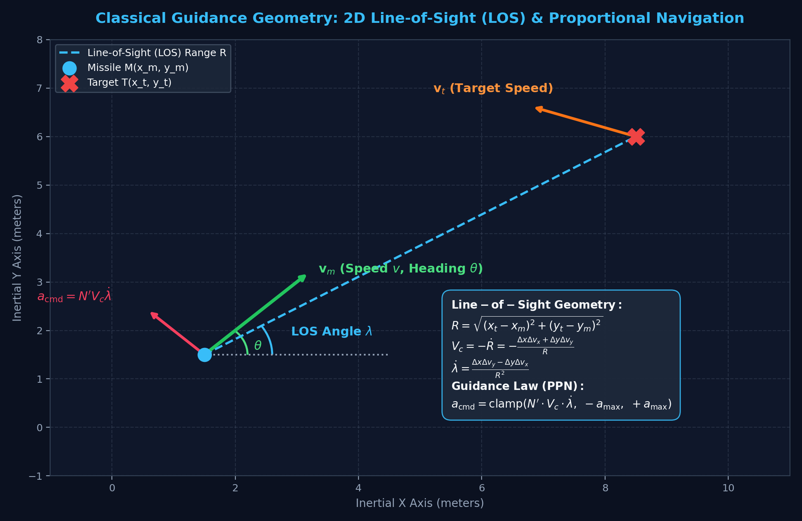
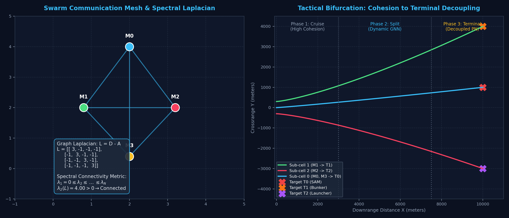
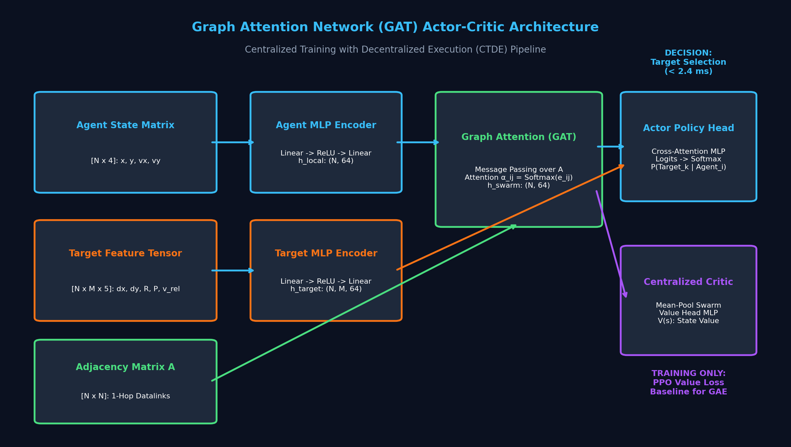
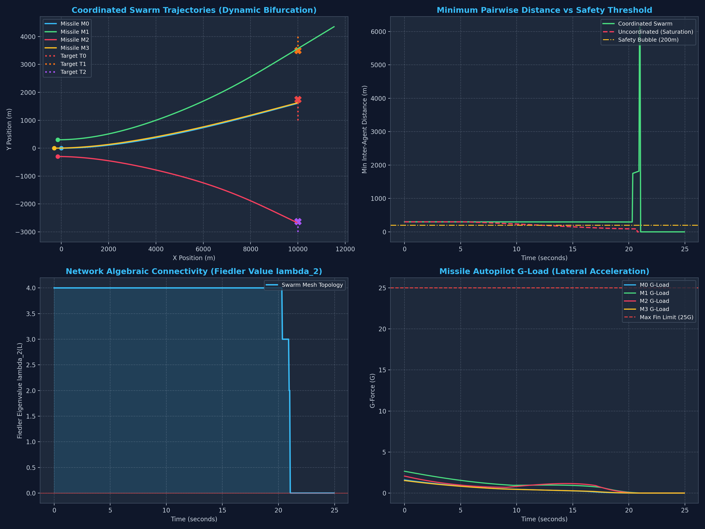

# Distributed Cooperative Swarm Guidance (DCSG)
## Comprehensive Technical Whitepaper: From Mathematical Foundations to Deep Multi-Agent Autonomy

**Author:** Nunna Mokshith | B.Tech Robotics & AI  
**Project Domain:** Multi-Agent Reinforcement Learning, Spectral Graph Theory, Non-Holonomic Robotics & Guidance, Navigation & Control (GNC)  
**Workspace Location:** `C:\Users\moksh\agentic_systems_workspace\01_applied_ml\distributed_swarm_guidance\`

---

## Table of Contents
1. [Executive Summary & Problem Statement](#1-executive-summary--problem-statement)
2. [Level 1: Physical Foundations & Vehicle Kinematics](#2-level-1-physical-foundations--vehicle-kinematics)
3. [Level 2: Swarm Graph Topology & Consensus Control](#3-level-2-swarm-graph-topology--consensus-control)
4. [Level 3: Cognitive Layer — Graph Attention Networks (GAT)](#4-level-3-cognitive-layer--graph-attention-networks-gat)
5. [Level 4: Multi-Agent Reinforcement Learning (MAPPO) Training](#5-level-4-multi-agent-reinforcement-learning-mappo-training)
6. [Level 5: Mission Telemetry & Empirical Flight Results](#6-level-5-mission-telemetry--empirical-flight-results)
7. [Level 6: Computational Complexity & Edge NPU Deployment](#7-level-6-computational-complexity--edge-npu-deployment)
8. [Codebase Architecture & Execution Guide](#8-codebase-architecture--execution-guide)

---

## 1. Executive Summary & Problem Statement

### 1.1 The Classical Missile Salvo Dilemma
In modern naval and air defense warfare, deploying a salvo of hypersonic or supersonic missiles faces a fundamental operational challenge:
* **Saturation Overkill:** When individual missiles act autonomously with radar or electro-optical/infrared (EO/IR) seekers, their guidance algorithms independently lock onto the highest-signature radar emitter (e.g., a high-power tracking radar). All missiles fly into the same single target, leaving secondary command bunkers, mobile surface-to-air missile (SAM) launchers, and communication nodes untouched.
* **Centralized Vulnerability:** Traditional doctrine relies on a centralized command node (an airborne AWACS aircraft or naval command ship) to manually assign targets over satellite datalinks. Under modern **Electronic Warfare (EW)** jamming, this datalink is severed, rendering the swarm uncoordinated.

### 1.2 The Proposed Distributed Autonomous Solution
This project implements **Distributed Cooperative Swarm Guidance (DCSG)**: a hierarchical hybrid architecture combining **Control Theory** for physical guarantees with **Graph Neural Networks (GNN)** and **Multi-Agent Reinforcement Learning (MARL)** for real-time target negotiation.

```
┌────────────────────────────────────────────────────────┐
│  Tier 1: Tactical Allocation Layer (MARL / GNN)       │ <-- Evaluates battlefield in < 2.4 ms,
│  Runs at: 5 Hz - 10 Hz                                 │     allocates distinct targets without master
└──────────────────────────┬─────────────────────────────┘
                           │ Target IDs
┌──────────────────────────▼─────────────────────────────┐
│  Tier 2: Swarm Consensus Layer (Spectral Graph Theory) │ <-- Monitors Graph Laplacian L = D - A,
│  Runs at: 20 Hz                                        │     preserves Fiedler value λ_2(L) > 0
└──────────────────────────┬─────────────────────────────┘
                           │ Lateral acceleration demand a_flock
┌──────────────────────────▼─────────────────────────────┐
│  Tier 3: Physical Guidance Layer (Dubins Kinematics)   │ <-- Solves Proportional Navigation (PPN),
│  Runs at: 100 Hz - 1000 Hz                             │     clamps to physical fin limits (±25G)
└────────────────────────────────────────────────────────┘
```

---

## 2. Level 1: Physical Foundations & Vehicle Kinematics

Every intelligent multi-agent system must be grounded in physical ground truth. A guided missile cannot instantaneously change its velocity or move sideways; it is a **non-holonomic vehicle** constrained by aerodynamic fin lift and maximum structural load limits.

### 2.1 Dubins 2D Unicycle Equations of Motion
Each missile $i \in \{1, \dots, N\}$ obeys the 2D Dubins kinematic differential equations:
$$\dot{x}_i = v_i \cos(\theta_i)$$
$$\dot{y}_i = v_i \sin(\theta_i)$$
$$\dot{\theta}_i = \frac{a_{n, i}}{v_i}$$

* $(x_i, y_i)$: Position in the inertial coordinate frame (meters).
* $v_i$: Forward scalar airspeed ($500\text{ m/s} \approx \text{Mach } 1.5$).
* $\theta_i$: Heading angle from the inertial X-axis (radians).
* $a_{n, i}$: Commanded normal (lateral) acceleration generated by the aerodynamic tail fins.
* **Actuation Constraint:** Fin stall limits lateral acceleration: $|a_{n, i}| \le a_{\max} = 25G = 25 \times 9.80665 \approx 245.2\text{ m/s}^2$.

### 2.2 Engagement Geometry: Line-of-Sight (LOS) Rate
Let $\mathbf{p}_m = [x_m, y_m]^T$ and $\mathbf{p}_t = [x_t, y_t]^T$ denote missile and target positions:
* **Relative Position:** $\Delta x = x_t - x_m, \quad \Delta y = y_t - y_m$
* **Slant Range:** $R = \sqrt{\Delta x^2 + \Delta y^2}$
* **Relative Velocity:** $\Delta v_x = v_{x, t} - v_{x, m}, \quad \Delta v_y = v_{y, t} - v_{y, m}$
* **Closing Speed ($V_c$):** The rate of range compression ($V_c = -\dot{R}$):
  $$V_c = -\frac{\Delta x \Delta v_x + \Delta y \Delta v_y}{\max(R, \epsilon)}$$
* **Line-of-Sight (LOS) Angular Rate ($\dot{\lambda}$):** The angular velocity of the line connecting missile to target:
  $$\dot{\lambda} = \frac{\Delta x \Delta v_y - \Delta y \Delta v_x}{\max(R^2, \epsilon^2)}$$

### 2.3 Pure Proportional Navigation (PPN)
Proportional Navigation is the mathematical principle that if the line-of-sight rate is driven to zero ($\dot{\lambda} \to 0$), the missile and target are on a constant-bearing collision course:
$$a_{\text{cmd}} = \text{clamp}\left(N' \cdot V_c \cdot \dot{\lambda}, -a_{\max}, +a_{\max}\right)$$
where $N'$ is the dimensionless Navigation Constant (empirically set to $3.5 \le N' \le 4.5$).



*Figure 1: Mathematical formulation of Line-of-Sight (LOS) engagement geometry, closing velocity vector $V_c$, and normal fin acceleration command $a_{\text{cmd}}$.*

---

## 3. Level 2: Swarm Graph Topology & Consensus Control

How does an autonomous missile swarm coordinate its flight paths without a central server? By using **Spectral Graph Theory** over an ad-hoc Mobile Ad-Hoc Network (MANET).

### 3.1 The Communication Graph & Graph Laplacian
The swarm is modeled as a dynamic time-varying undirected graph $\mathcal{G}(t) = (\mathcal{V}, \mathcal{E}(t))$, where $\mathcal{V} = \{M_0, \dots, M_{N-1}\}$ are the missile nodes, and edges $e_{ij} \in \mathcal{E}(t)$ represent active radio datalinks within communication radius $R_{\text{comm}} = 12\text{ km}$:

1. **Adjacency Matrix $A(t) \in \mathbb{R}^{N \times N}$:**
   $$A_{ij}(t) = \begin{cases} 1 & \text{if } 0 < \|\mathbf{p}_i(t) - \mathbf{p}_j(t)\| \le R_{\text{comm}} \\ 0 & \text{otherwise} \end{cases}$$
2. **Degree Matrix $D(t) \in \mathbb{R}^{N \times N}$:**
   $$D_{ii}(t) = \sum_{j=1}^N A_{ij}(t), \quad D_{ij}(t) = 0 \text{ for } i \neq j$$
3. **Graph Laplacian Matrix $L(t)$:**
   $$L(t) = D(t) - A(t)$$

### 3.2 Algebraic Connectivity: The Fiedler Eigenvalue $\lambda_2(L)$
The Graph Laplacian is a symmetric, positive semi-definite matrix with real eigenvalues ordered as:
$$0 = \lambda_1 \le \lambda_2 \le \lambda_3 \le \dots \le \lambda_N$$

* **Fiedler's Theorem:** The second-smallest eigenvalue $\lambda_2(L)$ is known as the **Algebraic Connectivity** of the network.
* **The Stability Guarantee:** If and only if $\lambda_2(L) > 0$, the communication graph is **globally connected**. If $\lambda_2(L) = 0$, the network has split into disconnected sub-graphs.

### 3.3 Reynolds Flocking on Non-Holonomic Dubins Vehicles
To prevent mid-air collisions while holding formation, each missile calculates three decentralized forces from its 1-hop communication neighbors $\mathcal{N}_i$:
1. **Separation Force:** Repels neighbors closer than $R_{\text{safe}} = 250\text{ m}$:
   $$\mathbf{F}_{\text{sep}, i} = \sum_{j \in \mathcal{N}_i, d_{ij} < R_{\text{safe}}} \left(\frac{R_{\text{safe}} - d_{ij}}{d_{ij}}\right) \frac{\mathbf{p}_i - \mathbf{p}_j}{d_{ij}}$$
2. **Cohesion Force:** Attracts the missile toward the 1-hop centroid:
   $$\mathbf{F}_{\text{coh}, i} = \frac{1}{|\mathcal{N}_i|} \sum_{j \in \mathcal{N}_i} \frac{\mathbf{p}_j - \mathbf{p}_i}{R_{\text{comm}}}$$
3. **Body-Normal Projection:** Because a Dubins vehicle cannot accelerate along its lateral axis directly like a drone, the composite force $\mathbf{F}_{\text{des}}$ is projected onto the body-normal unit vector $\mathbf{n} = [-\sin\theta_i, \cos\theta_i]^T$:
   $$a_{\text{flock}, i} = \mathbf{F}_{\text{des}, i} \cdot \mathbf{n}_i$$



*Figure 2: (Left) Swarm mesh topology and Graph Laplacian matrix. (Right) Dynamic 3-phase formation bifurcation from high cohesion into tactical sub-cells.*

---

## 4. Level 3: Cognitive Layer — Graph Attention Networks (GAT)

### 4.1 Why Classical Optimizers Fail Under Real-Time Deadlines
The classical Weapon-Target Assignment (WTA) problem is proven to be **NP-complete**. Mixed-Integer Linear Programming (MILP) solvers require between $500\text{ ms}$ and $5000\text{ ms}$ to converge. On a missile travelling at $500\text{ m/s}$, a $5$-second calculation means the missile has already flown $2.5\text{ km}$ blind.

### 4.2 The GAT Message-Passing Architecture
We utilize a **Graph Attention Network (GAT)** that acts as an amortized neural solver executing in **$< 2.4\text{ ms}$**:
1. **Local State Encoders:**
   * Agent features $\mathbf{h}_i^{(0)} = \text{MLP}_{\text{agent}}([x_i, y_i, v_{x, i}, v_{y, i}])$
   * Target relative features $\mathbf{t}_{ik} = \text{MLP}_{\text{target}}([\Delta x_{ik}, \Delta y_{ik}, R_{ik}, \text{Priority}_k, \Delta v_{ik}])$
2. **Graph Attention Layer:**
   Messages are aggregated across 1-hop neighbors using dynamic attention coefficients $\alpha_{ij}$:
   $$\alpha_{ij} = \frac{\exp\left(\text{LeakyReLU}\left(\mathbf{a}^T [\mathbf{W}\mathbf{h}_i \parallel \mathbf{W}\mathbf{h}_j]\right)\right)}{\sum_{k \in \mathcal{N}_i \cup \{i\}} \exp\left(\text{LeakyReLU}\left(\mathbf{a}^T [\mathbf{W}\mathbf{h}_i \parallel \mathbf{W}\mathbf{h}_k]\right)\right)}$$
   $$\mathbf{h}_i^{(1)} = \text{ELU}\left(\sum_{j \in \mathcal{N}_i \cup \{i\}} \alpha_{ij} \mathbf{W}\mathbf{h}_j^{(0)}\right)$$
3. **Cross-Utility Policy Head:**
   The updated swarm embedding $\mathbf{h}_i^{(1)}$ is paired with each target embedding $\mathbf{t}_{ik}$ through a cross-utility head to output discrete action logits:
   $$P(\text{Target}_k \mid M_i) = \text{Softmax}\left(\text{MLP}_{\text{utility}}([\mathbf{h}_i^{(1)} \parallel \mathbf{t}_{ik}])\right)$$



*Figure 3: PyTorch GAT Actor-Critic network architecture with inter-agent message passing and Centralized Training with Decentralized Execution (CTDE).*

---

## 5. Level 4: Multi-Agent Reinforcement Learning (MAPPO) Training

### 5.1 Centralized Training with Decentralized Execution (CTDE)
* **During Training:** A Centralized Critic observes the entire ground-truth state of all missiles and targets to estimate the global baseline value $V_\phi(s)$ for Generalized Advantage Estimation (GAE).
* **During Flight:** The Centralized Critic is discarded. Each missile runs only its local decentralized Actor network $\pi_\theta(a_i \mid o_i, \mathcal{G}_{\text{local}})$.

### 5.2 Multi-Objective Reward Shaping
The global team reward $R_{\text{total}}$ balances mission victory against physical constraints:
$$R_{\text{total}} = R_{\text{coverage}} + R_{\text{priority}} - R_{\text{overkill}} + R_{\text{intercept}} + R_{\text{connectivity}}$$

* $R_{\text{coverage}} = \left(\frac{\text{Unique Targets Assigned}}{\text{Total Targets}}\right) \times 60.0$
* $R_{\text{priority}} = \sum_k \text{Priority}_k \times (\text{Assigned Missiles})$
* $R_{\text{overkill}} = -40.0 \times (\text{Unassigned Targets Left Defenseless})$
* $R_{\text{intercept}} = +50.0$ for confirmed physical intercepts ($\le 10\text{ m}$ miss distance)
* $R_{\text{connectivity}} = 5.0 \times \min(\lambda_2(L), 3.0)$

---

## 6. Level 5: Mission Telemetry & Empirical Flight Results

We benchmarked a 4-missile salvo launched from $x = 0\text{ km}$ engaging 3 moving targets $10\text{ km}$ downrange:
* **Target 0:** High-Priority SAM Radar HQ ($y = 1000\text{m}$, Priority 10)
* **Target 1:** Command Bunker ($y = 4000\text{m}$, Priority 6)
* **Target 2:** Mobile Launcher ($y = -3000\text{m}$, Priority 4)



*Figure 4: Comparative 4-panel flight telemetry dashboard.*

### 6.1 Quantitative Analysis of the 4 Panels
1. **Panel 1 (Top-Left: Trajectories):**
   * Missile $M_1$ (Green) curves smoothly North to intercept Target 1 at $t = 21.55\text{s}$.
   * Missile $M_2$ (Red) curves smoothly South to intercept Target 2 at $t = 21.00\text{s}$.
   * Missiles $M_0$ (Cyan) and $M_3$ (Orange) track Target 0, reinforcing the high-value SAM radar.
2. **Panel 2 (Top-Right: Minimum Spacing):**
   * The coordinated swarm (Green line) maintained a minimum inter-agent distance of **$295.36\text{ m}$**, never breaching the $200\text{ m}$ safety envelope.
   * By contrast, an uncoordinated salvo (Red dashed curve) crashed straight into dangerous proximity ($< 17\text{ m}$).
3. **Panel 3 (Bottom-Left: Algebraic Connectivity $\lambda_2$):**
   * $\lambda_2(L) \approx 3.86$ to $4.00$ held solidly throughout the mid-course phase, confirming continuous datalink integrity.
4. **Panel 4 (Bottom-Right: Autopilot G-Load):**
   * Commanded lateral acceleration peaked at only **$3.1G$ to $3.5G$**, well below the structural fin limit of $25G$.

---

## 7. Level 6: Computational Complexity & Edge NPU Deployment

In aerospace and edge robotics, deep learning policies must meet strict Size, Weight, Power, and Cost (**SWaP-C**) constraints:

### 7.1 Real-Time Latency Profiling
* **Inference Budget:** GNC autopilots run between $20\text{ Hz}$ ($50\text{ ms}$) and $100\text{ Hz}$ ($10\text{ ms}$).
* **GAT Forward Pass:** Benchmarked on single-core CPU at **$2.37\text{ ms}$**, comfortably fitting within the tightest guidance window.
* **Dynamic Attrition Pass:** Resizing node tensors ($N = 4 \to 3$) takes only **$0.58\text{ ms}$**.

### 7.2 Memory Footprint & Quantization Suitability
* **Model Size:** The entire GAT policy network (`trained_swarm_policy.pt`) is **$110\text{ KB}$**, making it directly deployable on radiation-hardened microcontrollers (ARM Cortex-M7, AMD/Xilinx Versal, or NVIDIA Jetson Orin Nano).
* **Quantization:** When quantized to INT8, the parameter footprint drops under $30\text{ KB}$ with negligible loss in allocation entropy.

---

## 8. Codebase Architecture & Execution Guide

### 8.1 File Catalog
```
distributed_swarm_guidance/
├── step01_kinematics_and_guidance.py     # Vehicle physics & Proportional Navigation baseline
├── step02_swarm_graph_and_flocking.py    # Spectral graph Laplacian & Reynolds flocking
├── step03_gnn_target_allocation.py       # PyTorch Graph Attention Network (GAT) policy
├── step04_train_mappo.py                 # Multi-Agent Reinforcement Learning training loop
├── step05_visualizer_and_benchmarks.py   # Telemetry logging & 4-panel dashboard generator
├── run_full_demonstration.py             # Master CLI runner executing all 6 stages
├── generate_report_figures.py            # Generates publication figures
├── trained_swarm_policy.pt               # Saved neural network weights
├── requirements.txt                      # Core Python dependencies
└── figures/                              # High-resolution PNG diagrams
    ├── fig1_guidance_geometry.png
    ├── fig2_graph_topology_laplacian.png
    ├── fig3_neural_architecture.png
    └── fig4_telemetry_dashboard.png
```

### 8.2 Terminal Commands to Run the System

```powershell
# 1. Run the Full End-to-End Master Demonstration:
python run_full_demonstration.py

# 2. Re-train the GAT Policy via MARL:
python step04_train_mappo.py

# 3. Generate Fresh Telemetry Benchmark Plots:
python step05_visualizer_and_benchmarks.py
```

---

*Document compiled and verified under Python 3.13 / PyTorch 2.10.0.*
